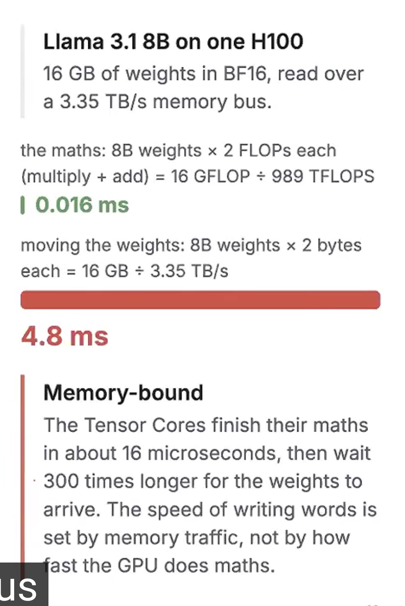
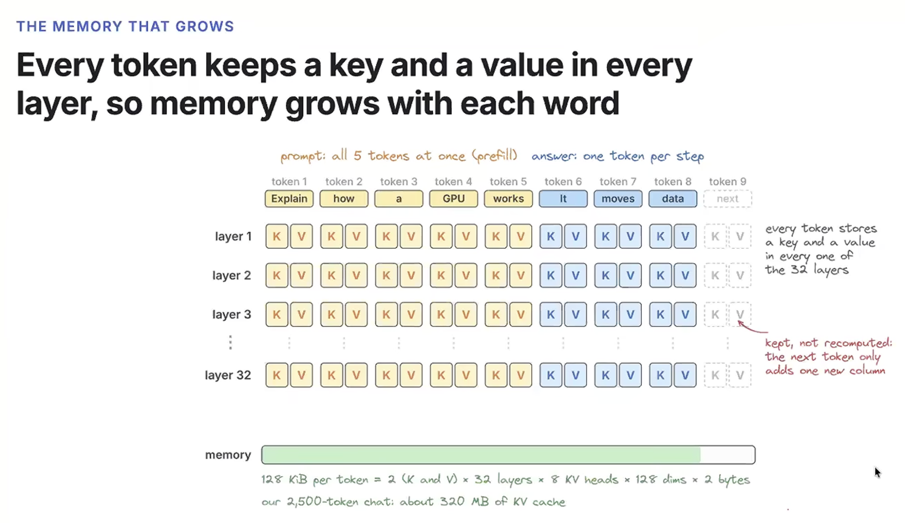
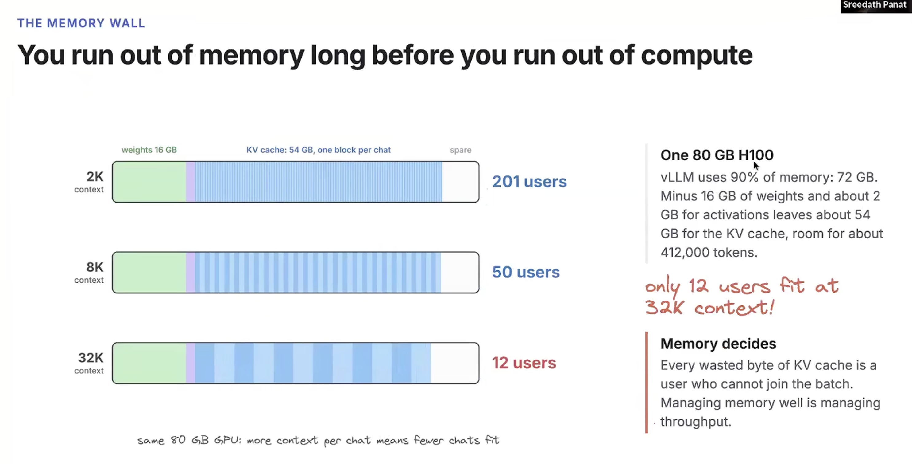

#### [How LLM Serving Works: An Introduction to vLLM and SGLang](https://www.youtube.com/watch?v=vM3kzJIPvvw)
* Llama3.1 8B (has 32 transformer layers) - 8 billion parameters in BF16 (2 bytes each): 16 GB of weights
* [H100](https://github.com/muarshad01/Kernel-Engg/blob/main/H100.md)

***

* 10:00
  
* VRAM - 80 GB and 16 GB is for weights.
* SRAM - 30 MB
* VRAM to SRAM data transfer speed: 3.35 TB/s
* Computation speed: 989 TFLOPs/s
* KV Cache per token: 128 KB
* KV Cache per 2,500 token chat: ~320 MB
* Left for KV Cache after weights: 54 GB

***

* 30:00
* Ollama or llama.cpp

  

p

***

* 40:00

* 80 GB -> 32 transformer layers -> 500 MB per layer

***

* 50:00

***

#### Size of KV_Cache
* l : number of transformer blocks layers
* b : batch size
* s : sequence length (context length)
* h : attention head dimension ($d_{head}$)
* $n_{heads}$ : number of attention heads
* 2 : number of byptes per PF (Assume each parameter takes 2 bytes)
* 2 : Two caches one each for (k,v)

$$\text{Bytes ~taken ~up ~by ~KV cache} = l \times b \times s \times \underbrace{h \times n_{heads}}_{d_{model}} \times 2 \times 2$$

***

* 1:00:00

  

  

#### Paged Attention

***

* 1:15:00

***

#### Static versus Continuous Batching

***

* 1:20:00

***

